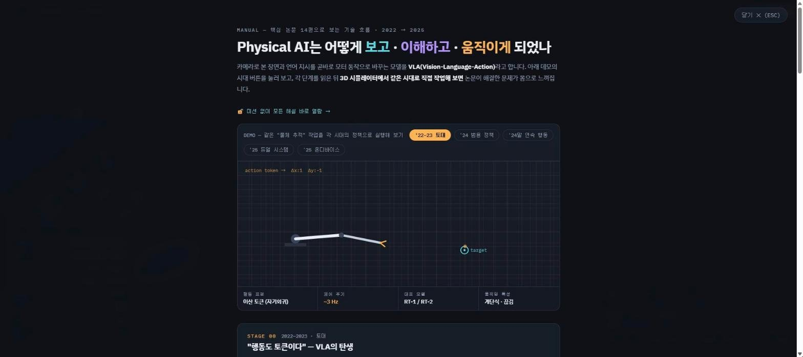

# Physical AI 3D Factory — 모바일 로봇 자동화 공장

모바일 로봇(4륜 차체, 회전대가 달린 2링크 팔, 그리퍼)을 조종해 3D 자동화 공장에 재료를 나르면서, 2022~2025년 Physical AI(VLA: Vision-Language-Action) 모델의 시대별 차이(제어 주기, 행동 양자화, 추론 지연 보정)를 직접 비교해 보는 웹 학습 시뮬레이터입니다. 학습 미션 10개와, 핵심 논문 14편을 단계별로 정리한 「Physical AI 발전사」 메뉴얼이 함께 들어 있습니다.

- 바로 보기: https://develop-korea-tech.github.io/physical-ai-sim/
- 형태: 단일 HTML 파일 · 설치 없음 · PC(키보드 · 마우스)와 모바일(터치) 지원
- 기술: HTML · CSS · JavaScript(빌드 도구 없음) · Three.js r128(cdnjs CDN, WebGL) · Canvas 2D · SVG
- 만든 시기: 2026-06 (마지막 업로드 기준)

| 3D 시뮬레이터 — '25 온디바이스 시대 로봇(Mk.5) | Physical AI 발전사 매뉴얼 — 시대별 데모와 논문 14편 |
|---|---|
|  |  |

## 1. 주요 기능

### 1-1. 3D 공장 장면

화면 전체가 Three.js로 그린 3D 장면이며, 로봇 한 대와 다음 설비가 놓여 있습니다.

| 설비 | 화면 표시 | 내용 |
|---|---|---|
| 재료 패드 | 회색 원판 위의 보라색 공 | 재료(공)가 생기는 곳입니다. 공을 들고 있지 않을 때는 공 위에 보라색 빛기둥이 표시됩니다. |
| 자동화 공장 | 건물 · 사일로 · 굴뚝 · 3색 신호등 | 투입구(청록 링)에 공을 넣으면 투입 컨베이어 → 프레스 3회 가공(불꽃) → 배출 컨베이어 → 출구 패드(주황 링) 순서로 금색 완제품이 나옵니다. 가공 시간은 2.3초입니다. |
| 조립 소켓 | 받침대 위의 작은 보라 링 | 공을 천천히 꽂아 넣는 정밀 작업 지점입니다. |
| 무빙 카트 | 레일 위를 약 14초 주기로 왕복하는 카트와 링 | 달리는 카트에 공을 싣는 작업 지점입니다. 링이 초록색일 때만 실을 수 있고, 양 끝 회차 구간에서는 빨간색입니다. |
| 통신 음영 구역 | 바닥의 빨간 원(반지름 3.2 m)과 가운데 배달 패드(주황 링) | Mk.1~Mk.4로 들어가면 통신이 끊겨 로봇이 멈췄다가 안전 모드로 밖에 밀려 나옵니다. Mk.5는 멈추지 않습니다. |

- 생산이 한 번 끝나면 재료 패드에 새 공이 생기고, 상태 패널의 생산 수량이 1 늘어납니다.
- 출구 패드의 완제품(금색 큐브)도 집어서 옮길 수 있습니다.
- 공이 공장 지붕 · 사일로 · 컨베이어에 떨어지면 바깥으로 튕겨 나옵니다. 음영 구역 안(Mk.5 제외)이나 1.2 m보다 높은 면에 3초 넘게 머문 공은 재료 패드로 되돌아갑니다(화면 알림: "회수 드론").

### 1-2. 시대별 로봇 5종

상단의 시대 버튼 5개로 기체를 바꿉니다. 외형과 팔의 제어 방식이 함께 바뀝니다. 아래 값은 코드의 `ERAS` 배열 그대로입니다.

| 시대 버튼 | 기체 | 대표 모델(표시) | 제어 주기 | 행동 격자 | 추론 지연 | 잡기 반경 |
|---|---|---|---|---|---|---|
| '22–23 토대 | Mk.1 연구용 리그 | RT-1 / RT-2 | 2.5 Hz | 0.5 m | 0 | 0.44 m |
| '24 범용 정책 | Mk.2 양산 1세대 | Octo / OpenVLA | 8 Hz | 0.2 m | 0 | 0.36 m |
| '24말 연속 행동 | Mk.3 협동로봇형 | π0 / CogACT | 50 Hz | 없음(연속) | 0 | 0.32 m |
| '25 듀얼 시스템 | Mk.4 산업 플래그십 | GR00T N1 / Gemini Robotics | 120 Hz | 없음(연속) | 0 | 0.32 m |
| '25 온디바이스 | Mk.5 온디바이스 에디션 | BitVLA / PD-VLA / RTC | 120 Hz | 없음(연속) | 0.35초 + RTC 보정 | 0.32 m |

- 제어 주기: 팔이 새 명령을 받는 횟수입니다. 2.5 Hz면 0.4초마다 한 번 움직입니다.
- 행동 격자: 격자가 있는 기체는 팔이 공간에 고정된 격자점으로만 이동합니다. 이때 팔 목표점 주변에 주황색 격자가 표시됩니다.
- 추론 지연과 RTC: Mk.5는 0.35초 전의 목표를 보고 움직이며, RTC 보정으로 그 사이 움직임을 예측해 명령을 앞당깁니다. 빨간 점이 보정 전 위치, 주황 점이 보정 후 명령 위치입니다.
- 화면에는 팔 목표점(청록 점과 링), 정책이 낸 명령(주황 점), 손끝이 지나간 궤적(주황 선), 손끝의 바닥 투영(주황 링)이 함께 표시됩니다.
- 외형은 Mk.1 회색 프레임 리그, Mk.2 흰 팔과 주황 포인트, Mk.3 백색 협동로봇, Mk.4 그라파이트와 시안 발광, Mk.5 블랙과 골드입니다.

### 1-3. 학습 미션 10개

미션은 1번부터 순서대로 진행하며, 미션마다 쓰는 기체가 정해져 있습니다. 표의 "벽 미션"은 그 시대 기체로는 해내기 어렵게 만든 미션입니다. 배너에 "이건 못 하겠어요 →" 버튼이 나오며, 이 버튼을 누르거나 제한 시간(미션 2 · 4 · 9)이 지나면 "WALL — 벽을 발견했습니다" 결과로 넘어갑니다.

| 번호 | 화면 제목 | 기체 | 할 일 | 비고 |
|---|---|---|---|---|
| 1 | 첫 출근 | Mk.1 | 공을 투입구에 넣어 완제품 1개 생산 | |
| 2 | 미니게임 ①: 정밀 조립 | Mk.1 | 공을 조립 소켓에 꽂기 | 벽 미션, 45초 |
| 3 | 신형 도입: Mk.2 | Mk.2 | 미션 2와 같은 소켓 작업 | 미션 2 기록과 비교 |
| 4 | 미니게임 ②: 무빙 카트 | Mk.2 | 달리는 카트에 공 싣기 | 벽 미션, 50초 |
| 5 | 흐르는 손 | Mk.3 | 미션 4와 같은 카트 작업 | 미션 4 기록과 비교, 퀴즈 |
| 6 | "자동으로 안 되나?" | Mk.3 | 자율 동작 관찰(조작 잠김) | 벽 미션 |
| 7 | 미니게임 ③: 계획을 짜다 | Mk.3 | 블록으로 행동 순서를 만들어 실행, 완제품 1개 | |
| 8 | 스스로 계획을 세우다 (그런데…) | Mk.4 | 로봇이 직접 채운 블록 계획의 실행 관찰, 완제품 1개 | 클라우드 두절 반복 |
| 9 | 미니게임 ④: 음영 구역 배달 | Mk.4 | 공을 음영 구역 가운데 배달 패드에 놓기 | 벽 미션, 50초 |
| 10 | 두뇌를 싣다 | Mk.5 | 미션 9와 같은 배달 | 퀴즈 |

- 미션 중에는 화면 위 배너에 목표, 현재 단계와 목표까지 거리, 경과 시간이 표시됩니다. 미션 종류에 따라 소켓까지 거리, 카트와의 상대속도(✓/✗), 통신 두절 상태도 함께 나옵니다. 블록 · 자율 미션(6~8)이 아니면 목표 지점 위에 원뿔 표시와 빛기둥이 서고, 로봇에서 목표까지 바닥에 점선이 그려집니다.
- 미션을 마치면 결과 창에 걸린 시간 · 평균 팔 오차(cm) · 놓친 횟수, 이전 기체와의 비교, 그림, 시대 해설이 나옵니다. 미션 5와 10은 체크 퀴즈의 정답을 골라야 다음 버튼(미션 5는 "다음 미션 →", 미션 10은 "수료 결과 보기")이 켜집니다.
- 미션 10 뒤 "수료 결과 보기"를 누르면 미션별 기록 표가 나오고 메뉴얼 해설이 모두 열립니다.

### 1-4. 「Physical AI 발전사」 메뉴얼

`M` 키 또는 "☰ 메뉴" → "📖 Physical AI 발전사 메뉴얼"로 여는 전체 화면 문서입니다. 화면 위쪽 표기는 "MANUAL — 핵심 논문 14편으로 보는 기술 흐름 · 2022 → 2025"입니다.

- 맨 위 데모: 같은 "물체 추적" 작업을 시대별 정책으로 실행하는 2D 로봇 팔 애니메이션입니다. 시대 버튼 5개로 바꾸면 행동 표현 · 제어 주기 · 대표 모델 · 움직임 특성 값이 함께 바뀝니다.
- 단계 6개(STAGE 00~05): STAGE 00~04는 설명 문단, 데모, 논문 링크, 3D 시뮬레이터에서 같은 시대를 체험하는 방법("▶ 3D 시뮬레이터에서 체험")으로 구성되고, STAGE 05는 요약 문단만 있습니다.

| 단계 | 시기(페이지 표기) | 제목 | 데모 | 논문 수 |
|---|---|---|---|---|
| STAGE 00 | 2022–2023 · 토대 | "행동도 토큰이다" — VLA의 탄생 | Diffusion Policy 노이즈 제거 과정 | 4 |
| STAGE 01 | 2024 상반기 · 데이터 스케일링 | 누구나 쓰는 "범용 정책"의 등장 | 교차-신체(Cross-Embodiment) 학습 흐름 | 2 |
| STAGE 02 | 2024 하반기 · 새 아키텍처 | 이산 토큰을 버리고 연속 행동으로 | 이산 토큰과 연속 행동 궤적 비교 | 3 |
| STAGE 03 | 2025 상반기 · 인프라와 추론 | 빅테크의 참전 — 추론하는 몸, 듀얼 시스템 | 듀얼 시스템(System 2 / System 1) 그림 | 2 |
| STAGE 04 | 2025 중반 · 엣지 최적화 | 현장 투입 — 로봇 안에서 도는 VLA | BitVLA · PD-VLA · RTC 데모 3개 | 3 |
| STAGE 05 | 2025 이후 | 그 이후 — 수렴하는 다섯 갈래 | 없음(요약 문단) | 0 |

수록 논문 14편입니다. 이름과 설명은 페이지 표기 그대로이며, 링크는 모두 arXiv 초록 페이지입니다.

| 단계 | 논문 | 페이지의 설명 | arXiv |
|---|---|---|---|
| 00 | RT-1 | 행동의 토큰화 | [2212.06817](https://arxiv.org/abs/2212.06817) |
| 00 | RT-2 | 최초의 본격 VLA | [2307.15818](https://arxiv.org/abs/2307.15818) |
| 00 | Diffusion Policy | 노이즈 제거로 행동 생성 | [2303.04137](https://arxiv.org/abs/2303.04137) |
| 00 | Open X-Embodiment | 로봇계의 ImageNet | [2310.08864](https://arxiv.org/abs/2310.08864) |
| 01 | Octo | 오픈소스 범용 정책 | [2405.12213](https://arxiv.org/abs/2405.12213) |
| 01 | OpenVLA | 7B 오픈 VLA | [2406.09246](https://arxiv.org/abs/2406.09246) |
| 02 | π0 | flow matching 50Hz | [2410.24164](https://arxiv.org/abs/2410.24164) |
| 02 | CogACT | 인지·행동 분업 | [2411.19650](https://arxiv.org/abs/2411.19650) |
| 02 | RoboVLMs | 설계 공간 지도 | [2412.14058](https://arxiv.org/abs/2412.14058) |
| 03 | Gemini Robotics | 프런티어 VLM의 신체화 | [2503.20020](https://arxiv.org/abs/2503.20020) |
| 03 | GR00T N1 | 휴머노이드 파운데이션 모델 | [2503.14734](https://arxiv.org/abs/2503.14734) |
| 04 | BitVLA | 1-bit 양자화 | [2506.07530](https://arxiv.org/abs/2506.07530) |
| 04 | PD-VLA | 병렬 디코딩 | [2503.02310](https://arxiv.org/abs/2503.02310) |
| 04 | RTC | 실시간 청킹 | [2506.07339](https://arxiv.org/abs/2506.07339) |

- 다루는 시기는 페이지 표기 기준 2022 → 2025입니다. arXiv 번호 앞 네 자리(제출 연월) 기준으로는 2212(2022년 12월)부터 2506(2025년 6월)까지입니다.
- 미션으로 시작하면 각 단계의 본문이 잠겨 있고(제목과 "🔒 해당 미션을 클리어하면 해설이 열립니다"만 보임), 해당 미션을 마치면 열립니다. 첫 화면에서 자유 탐색을 고르거나, 메뉴얼 위쪽의 "🔓 미션 없이 모든 해설 바로 열람 →"을 누르거나, 미션 10개를 모두 마치면 전부 열립니다.
- 메뉴얼 맨 아래에 구성 출처로 유튜브 영상 「Physical AI 핵심 논문 14편 리뷰」(엥지유니버스, 2025.12.12)가 표기되어 있습니다. 시뮬레이터의 시대별 동작(주기 · 양자화 · 지연 · 보정)은 교육용 단순화 모델이라는 안내도 함께 있습니다.

### 1-5. 상태 패널

왼쪽 아래 "Robot & Factory Status" 패널에 다음 값이 표시됩니다.

| 항목 | 내용 |
|---|---|
| 대표 모델 · 기체 세대 | 현재 시대의 모델 이름과 기체 이름 |
| 제어 주기 | 예: 2.5 Hz (Mk.5는 "120 Hz · 지연흡수") |
| 추론 지연 | "0 (가정)" 또는 "350ms → RTC 보정" |
| 팔 추종 오차 | 손끝과 목표점 사이 거리를 매 프레임 평활한 값(cm, 0.25초마다 갱신). 15 cm 이하 초록, 35 cm 이하 주황, 그보다 크면 빨강 |
| 그리퍼 | 열림 / 닫힘 / 잡는 중 |
| 공장 | 대기 / 가공 중 N% |
| 생산 수량 | 완제품 누적 개수 |

## 2. 조작 방법

### PC (키보드 · 마우스)

| 입력 | 동작 |
|---|---|
| `W` / `S` | 로봇 전진 / 후진 |
| `A` / `D` | 왼쪽 / 오른쪽으로 회전 |
| `↑` / `↓` | 팔 목표점을 로봇 앞쪽 / 뒤쪽으로 이동 |
| `←` / `→` | 팔 목표점을 로봇 왼쪽 / 오른쪽으로 이동 |
| `Q` / `E` | 팔 목표점 올리기 / 내리기 |
| `Space` | 집기 / 놓기 |
| `M` | 메뉴얼 열기 (열린 상태에서 `M` 또는 `Esc`로 닫기) |
| 마우스 드래그 | 카메라 회전 |
| 마우스 휠 | 카메라 줌 |

### 모바일 (터치)

터치 기기로 판정되면 화면 아래에 가상 조이스틱 2개와 버튼 3개가 나타납니다.

| 입력 | 동작 |
|---|---|
| 왼쪽 스틱("주행") | 위아래로 전진 · 후진, 좌우로 회전 |
| 오른쪽 스틱("팔") | 팔 목표점 앞뒤 · 좌우 이동 |
| `▲` / `▼` | 누르고 있는 동안 팔 목표점 올리기 / 내리기 |
| `✊` | 집기 / 놓기 |
| 빈 화면 한 손가락 드래그 | 카메라 회전 |
| 두 손가락 벌리기 · 오므리기 | 카메라 줌 |

### 사용 시 참고

- 손끝이 물체에 충분히 가까워지면(시대별 잡기 반경 안) 물체가 깜박이며 빛납니다. 이때 집기를 누르면 집힙니다. 가까운 물체가 없으면 그리퍼만 열리고 닫힙니다.
- 공은 팔을 멈춘 뒤 놓습니다. 손끝이 초속 0.6 m보다 빠를 때 놓으면 공이 던져지고, 소켓(0.6 m/s 초과)과 배달 패드(0.8 m/s 초과)에서는 너무 빠르다는 이유로 실패 처리됩니다.
- `Space`와 `M`은 짧게 눌렀다 뗍니다. 누르고 있으면 키 반복 입력 때문에 집기와 놓기(또는 메뉴얼 열기와 닫기)가 번갈아 반복됩니다.
- 안내 창이나 결과 창이 떠 있는 동안에는 키보드 입력을 받지 않습니다. 창 안의 버튼을 누릅니다.
- 자율 동작 중(미션 6, 미션 7 · 8의 계획 실행 중)과 통신이 끊긴 동안에는 주행 · 팔 · 집기 입력이 무시됩니다.
- 미션 진행 중에는 시대 버튼을 눌러도 기체가 바뀌지 않습니다("미션 진행 중에는 시대가 고정됩니다" 알림).
- 오른쪽 아래 조작법 상자는 "☰ 메뉴" → "조작법 보이기/숨기기"로 숨기거나 다시 보일 수 있습니다.

## 3. 실행 방법

### 3-1. 인터넷에서 바로 보기

1. 크롬 등 브라우저에서 https://develop-korea-tech.github.io/physical-ai-sim/ 를 엽니다.
2. 3D 장면 위에 안내 창이 뜹니다. "다음"을 누르면 조작법과 진행 방식 설명이 차례로 나옵니다(모두 3장).
3. 마지막 장에서 시작 방법을 고릅니다.
   - "🎯 미션 1 시작": 미션 1부터 순서대로 진행합니다.
   - "자유 탐색으로 시작": 미션 없이 자유롭게 조작합니다. 메뉴얼 해설도 모두 열립니다. 앞의 두 장에 있는 "건너뛰고 자유 탐색" 버튼도 같은 동작입니다.
4. 자유 탐색 중에도 왼쪽 위 "☰ 메뉴" → "🎯 학습 미션 시작/재시작"을 누르면 미션 1부터 시작합니다. 미션 중에는 배너의 "미션 그만두기"를 누르면 자유 탐색으로 돌아갑니다.

같은 파일이 저장소의 `Physical-AI-발전사/` 폴더 주소(https://develop-korea-tech.github.io/physical-ai-sim/Physical-AI-%EB%B0%9C%EC%A0%84%EC%82%AC/)로도 열립니다.

### 3-2. 내 PC에서 실행하기

1. 저장소 페이지(https://github.com/develop-korea-tech/physical-ai-sim) 위쪽의 초록색 **Code** 버튼 → **Download ZIP**을 누릅니다.
2. 내려받은 `physical-ai-sim-main.zip` 파일을 마우스 오른쪽 버튼 → **압축 풀기**(또는 "모두 추출")로 풉니다.
3. 풀린 `physical-ai-sim-main` 폴더에서 `index.html`을 더블클릭합니다. 기본 브라우저에서 열립니다(크롬 권장). 이후 진행은 3-1의 2번부터와 같습니다.
4. 주의사항
   - 인터넷 연결이 필요합니다. 3D 라이브러리 Three.js r128을 cdnjs(`https://cdnjs.cloudflare.com/ajax/libs/three.js/r128/three.min.js`)에서 받아 옵니다. 받지 못하면 3D 스크립트가 시작 부분(`new THREE.WebGLRenderer`)에서 멈추므로 3D 장면, 안내 창, 메뉴, 키보드 조작이 모두 동작하지 않습니다.
   - 글꼴(IBM Plex Sans KR, IBM Plex Mono)은 Google Fonts에서 받습니다. 인터넷이 없으면 기본 글꼴로 보입니다.
   - 로컬 서버는 필요 없습니다. 외부 파일을 `fetch`로 읽지 않으므로 더블클릭(`file://`)으로 열어도 됩니다.
   - WebGL을 지원하는 브라우저가 필요합니다.
   - 소리는 나지 않습니다.
   - PC에서는 키보드가 필요합니다. 마우스로는 카메라만 움직일 수 있습니다. 전체 조작법 상자는 화면 폭이 760px보다 넓을 때 보입니다.
   - 진행 상황은 저장되지 않습니다. 새로고침하면 안내 창부터 다시 시작합니다.
   - `Physical-AI-발전사/index.html`도 같은 파일이므로 어느 쪽을 열어도 같습니다.

## 4. 파일 구성

| 파일 | 설명 |
|---|---|
| `index.html` | 프로그램 전체(3,112줄, 약 150 KB). CSS, HTML, 스크립트 2개가 모두 이 파일 안에 있습니다. |
| `Physical-AI-발전사/index.html` | 루트 `index.html`과 같은 파일 사본입니다(2026-06-12 업로드 기준 바이트 단위로 동일). GitHub Pages의 `/Physical-AI-발전사/` 주소로 열립니다. |
| `README.md` | 이 문서 |

`index.html` 내부 구성

| 줄 | 내용 |
|---|---|
| 7 | Google Fonts 링크 |
| 8–366 | CSS. 색상 변수 `--vis`(청록) · `--lang`(보라) · `--act`(주황) · `--good`(초록) · `--bad`(빨강) |
| 370–636 | HTML. 3D 캔버스 `#scene`, 상단 바, 메뉴, 미션 배너, 모달, 메뉴얼 `#manual`(408–590), 상태 패널, 조작법, 블록 패널, 터치 UI, 알림 |
| 638 | Three.js r128 `<script src>` (cdnjs) |
| 639–2663 | 스크립트 1: 3D 시뮬레이터 |
| 2666–3110 | 스크립트 2: 메뉴얼 2D 데모(Canvas 2D) |

## 5. 작동 원리

### 5-1. 전체 구조

```
index.html
├─ <head>    Google Fonts 링크, <style>(CSS)
├─ <body>    화면 요소(캔버스 · 상단 바 · 메뉴 · 배너 · 모달 · 메뉴얼 · 패널 · 터치 UI)
├─ <script src>  Three.js r128 (cdnjs)
├─ <script> 1  3D 시뮬레이터 (즉시 실행 함수 하나)
│    ERAS(시대 5종) → 씬 · 조명 · 바닥 → 로봇 골격 + 외장(skin0~skin4)
│    → 목표점 · 명령점 · 궤적 마커 → 재료 패드 · 조립 소켓 · 무빙 카트 · 음영 구역
│    → 공장(factory 그룹) · 공 · 완제품 → 메뉴 · 키보드 · 마우스 · 터치 입력
│    → IK → MISSIONS(미션 10개) · 블록 패널 · 안내 창 → setEra(0) → animate()
└─ <script> 2  메뉴얼 2D 데모 (즉시 실행 함수 하나, Canvas 2D)
     M_ERAS → drawArm · drawDiff · drawXem · drawFlow · drawBit · drawPD · drawRTC
     → window.mdStart() / window.mdStop()
```

두 스크립트는 각각 즉시 실행 함수 안에 있어 서로의 변수를 볼 수 없고, 스크립트 1의 `openManual()` · `closeManual()`이 스크립트 2의 `window.mdStart()` · `window.mdStop()`을 부르는 것으로만 연결됩니다.

### 5-2. 화면 구성

| 요소 | 위치(z-index) | 역할 |
|---|---|---|
| `#scene` | 전체 화면, 가장 아래 | Three.js WebGL 렌더링 결과 |
| `.topbar` | 위쪽(10) | "☰ 메뉴"(`#menuBtn`), 시대 버튼 `.era-btn` 5개 |
| `#menuPop` | 왼쪽 위(30) | 메뉴 3항목(미션 시작, 메뉴얼, 조작법 보이기/숨기기) |
| `#mBanner` | 위쪽 가운데(9) | 미션 배너 |
| `.readout` | 왼쪽 아래(10) | 상태 패널 |
| `#helpBox` | 오른쪽 아래(10) | 조작법 요약과 목표 문구 |
| `#blockPanel` | 아래 가운데(30) | 블록 계획 패널(미션 7 · 8) |
| `#touchUI` | 전체(12) | 가상 조이스틱과 버튼. 터치 기기에서만 표시(`body.touch`) |
| `#toast` | 위쪽 가운데(11) | 알림, 2.2초 표시 |
| `#manual` | 전체 화면(40) | 발전사 메뉴얼. 자체 세로 스크롤 |
| `#mModal` | 전체 화면(60) | 안내 창 · 미션 결과 · 수료 화면 |

터치 기기 판정은 `'ontouchstart' in window` 또는 `(pointer: coarse)` 미디어 쿼리입니다. 판정되면 `body`에 `touch` 클래스가 붙어 조이스틱이 보이고 조작법 상자가 숨겨지며, 그림자 해상도도 2048에서 1024로 낮아집니다.

### 5-3. 메인 루프

`animate()`가 `requestAnimationFrame`마다 실행됩니다. 프레임 간격 `dt`는 최대 0.05초로 제한하고, 누적 시간은 `simT`에 더합니다.

```
animate()
 1. zoneTick() · cloudTick()    통신 두절 · 안전 모드이면 이번 프레임의 조작을 멈춤
 2. 주행 입력                    자율 모드면 planStep() / autoStep(), 아니면 키보드 + 터치
 3. 로봇 이동                    이동 범위 ±9.5 m, 공장 중심 2.9 m 이내 진입 차단, resolveColliders()
 4. 팔 목표점 targetL 갱신      방향키 · Q/E · 오른쪽 스틱, 카트 추적 보조, 도달 범위로 제한
 5. pushHist()                   목표점을 1.2초 동안 기록
 6. 정책 샘플링(1/rate초마다)   지연 · RTC 예측 · 격자 양자화 → 명령점 cmdL
 7. 팔 구동                      eeL을 cmdL 쪽으로 보간 → solveIK() → 관절 회전
 8. 손끝 속도 eeVel · eeSpeed   놓기 판정과 던지기에 사용
 9. 공 · 완제품 물리, 떨어지는 공의 성공 판정
10. 강조 표시                    잡을 수 있는 물체 발광, 공을 들면 투입구 링 깜박임
11. updateFactory() · updateCart()
12. 마커 갱신                    목표점 · 명령점 · 빨간 점 · 격자 · 궤적(최근 240점) · 그리퍼 투영
13. 소켓 · 배달 성공 연출, 회수 드론(3초)
14. updateObjectiveMarker(), 미션 타이머, 벽 미션 제한 시간 검사
15. 팔 추종 오차 표시(0.25초마다) → 카메라가 로봇과 손끝의 중간을 따라감 → renderer.render()
```

### 5-4. 시대별 정책 모델

시대 차이는 "목표점을 얼마나 자주, 얼마나 촘촘하게, 얼마나 늦게 보느냐"로 재현합니다. 사용자가 움직이는 것은 목표점 `targetL`이고, 팔은 정책이 낸 명령점 `cmdL`을 따라갑니다.

```
매 프레임       pushHist(simT, targetL)                         목표점 기록(1.2초 보관)
1/rate초마다    obs = targetL                                   지연 없음(Mk.1~Mk.4)
                obs = targetAtPast(simT - latency)              Mk.5: 0.35초 전 목표(빨간 점)
                obs += (obs - targetAtPast(simT - latency - 0.1)) / 0.1 × latency × 0.85
                                                                RTC: 직전 0.1초 변화로 예측
                grid > 0이면 obs를 월드 좌표로 바꿔 x · z는 grid 배수, y는 max(0.2, grid 배수)로 반올림
                cmdL = obs                                      주황 점
매 프레임       eeL += (cmdL - eeL) × (1 - (1 - snap)^(dt × 60))
                관절 각도 += (solveIK(eeL) - 관절 각도) × 0.7(Mk.1 · Mk.2) 또는 0.5(Mk.3~Mk.5)
```

- 격자 양자화는 월드 좌표에서 하므로 격자는 로봇이 아니라 공간에 고정되어 있습니다.
- `snap`은 Mk.1 0.65, Mk.2 0.45, Mk.3 0.17, Mk.4 · Mk.5 0.16입니다. Mk.1은 낮은 주기로 받은 격자점에 빠르게 튀어 가므로 동작이 끊겨 보입니다.
- 카트 추적 보조: 공을 든 채 손끝을 카트 근처(레일 선에서 0.9 m, 레일을 따라 카트에서 1.0 m 이내, 높이 1.3 m 미만)에 두면 목표점이 카트 속도만큼 함께 움직입니다. 연속 정책 기체는 이 목표를 매끄럽게 따라가고, 격자 기체는 양자화 때문에 끊어집니다.

### 5-5. 팔과 로봇 이동

- 로봇: 전진 속도 2.4 m/s, 회전 1.9 rad/s입니다. 사일로 · 투입 컨베이어 · 배출 컨베이어 · 소켓 받침 주변의 충돌 원(`COLLIDERS`)과 카트 레일 선분을 `resolveColliders()`가 밀어내기로 처리합니다.
- 팔 구조: 차체 위 회전대(`yawG`) → 어깨(`shoulderG`, 링크 1.45 m) → 팔꿈치(`elbowG`, 링크 1.25 m) → 손목(`wristG`) → 손가락 2개입니다. 그립 지점은 손목에서 0.31 m 앞입니다.
- `solveIK(p)`: 수평 방향으로 회전대 각도를 구하고, 어깨 · 팔꿈치 각도는 2링크 코사인 법칙으로 계산합니다. 손목 링크에 그립 오프셋을 더한 길이 `L2E`(1.56 m)를 써서 그립 지점이 목표에 맞도록 합니다.
- 목표점 제한: 높이는 차체 윗면 기준 −0.32~2.3 m, 수평 거리는 0.45~2.89 m(`L1 + L2E - 0.12`)입니다. 목표점 이동 속도는 2.0 m/s입니다.
- 시대를 바꾸면 `buildSkin(i)`가 `clearSkin()`으로 이전 외장을 지우고 `skin0()`~`skin4()` 중 하나로 새 외장을 만듭니다. 관절 구조와 손가락은 모든 시대에 공통입니다.

### 5-6. 공 물리와 성공 판정

- 공은 중력(9.8 m/s²)으로 떨어지고, 초속 2.2 m보다 빠르게 떨어지면 0.35배로 튀어 오르며, 바닥에서는 마찰로 멈춥니다. `supportHeightAt(x, z)`가 공 아래 면의 높이(패드, 소켓 받침, 카트, 로봇 차체, 공장 구조물)를 돌려줍니다. 공장 지붕 · 사일로 · 컨베이어 위에 닿으면 공장 바깥쪽으로 튕겨 냅니다.
- 놓은 공은 손끝 속도의 0.6배(축마다 최대 3 m/s)로 수평 이동을 시작합니다. 놓는 순간 손끝 속도가 0.6 m/s를 넘었으면 `thrown`(던짐) 표시가 붙습니다.
- 성공 판정은 놓는 순간(`toggleGrip()`)과 떨어지는 동안(`animate()`) 두 번 합니다.

| 목표 | 놓는 순간 판정 | 떨어지는 동안 판정 | 성공 후 |
|---|---|---|---|
| 공장 투입구 | 투입 지점 `INPUT_W`에서 0.5 m 이내 | 공장 대기 중, 수평 0.34 m 이내, 높이 0.55~1.5 m(던진 공도 인정) | `facIntake()` → 2.3초 가공 → 완제품 |
| 조립 소켓 | `SOCKET_W`에서 `sockR` 이내(기본 0.15 m, 미션 2 · 3은 0.25 m), 손끝 0.6 m/s 이하 | 수평 `sockR` 이내, 높이 0.55~1.2 m, 낙하 중, 던지지 않은 공 | 1.4초 꽂혀 있다가 재료 재생성 |
| 무빙 카트 | 카트 중심 0.30 m 이내, 카트 속도 0.4 m/s 이상, 손끝과 카트의 상대속도 0.35 m/s 이하 | 없음 | 1.6초 실려 있다가 재료 재생성 |
| 배달 패드 | `DELIVER_W`에서 0.35 m 이내, 손끝 0.8 m/s 이하 | 수평 0.35 m 이내, 높이 0.85 m 미만, 낙하 중, 던지지 않은 공 | 1.4초 뒤 재료 재생성 |

미션 중에 공을 네 작업 지점(투입구 · 소켓 · 카트 · 배달 패드) 밖에서 놓거나, 작업 지점에서 위 조건(속도 등)을 어기면 놓침 횟수(`mission.drops`)가 1 늘어납니다.

### 5-7. 상태기계

공장 `fac` (`facIntake()`, `updateFactory()`)

```
idle ──facIntake()──▶ processing ──(fac.t ≥ DUR 2.3초)──▶ idle
                       0~0.9초    공이 투입 컨베이어를 따라 이동
                       0.9~2.3초  프레스 3회 하강, 매회 불꽃(burstSparks)
                       완료       spawnProduct() · spawnMaterial() · missionEvent('produce')
```

가공 중에는 컨베이어가 빨라지고(벨트 속도 0.12 → 0.9), 신호등이 주황으로 깜박이며, 굴뚝 연기가 오르고, 상태 패널에 "가공 중 N%"가 표시됩니다. 완제품은 약 1.1초에 걸쳐 배출 컨베이어를 지나 출구 패드의 3×3 자리(`getOutSlot()`)로 옮겨집니다.

통신 음영 구역 `zone` (`zoneTick()`)

```
out ─(구역 진입)─▶ warn ─(0.6초)─▶ frozen ─(1.6초)─▶ eject ─(반지름 + 0.3 m 밖)─▶ out
                    └─(구역 이탈)─▶ out              eject: 구역 바깥쪽으로 1.3 m/s 자동 이동
Mk.5: 구역에 들어가면 ondev 상태가 되어 알림만 띄우고 멈추지 않음
```

클라우드 두절 `cloud` (`cloudTick()`, 미션 8에서만 켜짐): 미션 시작 4초 뒤 첫 두절이 생기고, 이후 5.5~9.5초(무작위) 간격으로 1.5초씩 로봇이 멈춥니다. 두절 횟수는 결과 창에 표시됩니다.

`frozen` · `eject` 상태와 클라우드 두절 중에는 `commFrozen`이 켜져 주행 · 팔 · 집기 키 입력이 무시되고 자율 동작도 멈춥니다. 그중 두절(`frozen`, 클라우드 두절) 동안에는 정책 샘플링도 멈춰 팔이 마지막 명령점에 머무릅니다.

### 5-8. 미션 진행

`MISSIONS` 배열 항목의 필드입니다.

| 필드 | 뜻 |
|---|---|
| `era` | 사용할 기체(`ERAS` 인덱스) |
| `no` · `title` · `goal` | 번호, 제목, 배너 목표 문구 |
| `type` | 완료 이벤트 종류: `produce` · `socket` · `cart` · `deliver` · `autofail` |
| `timed` | 결과 창에 시간 · 평균 팔 오차 · 놓침 표시 |
| `wall` · `failAfter` | 벽 미션 여부("이건 못 하겠어요 →" 버튼), 제한 시간(초) |
| `socketR` | 소켓 판정 반경 |
| `compare` | 결과 창에서 비교할 이전 미션 인덱스 |
| `quiz` | 체크 퀴즈 `{q, opts, ans, expl}` |
| `auto` · `blocks` · `cloud` | 자율 실패 연출 / 블록 패널(`'user'` 사용자 조립, `'auto'` 자동 채움) / 클라우드 두절 |
| `unlock` | 완료 시 열리는 메뉴얼 단계 번호 |
| `svg` · `brief` · `briefFn` | 결과 창의 그림과 해설 |

진행 상태는 `mission` 객체 하나에 담깁니다: `idx`(현재 미션), `active`, `startT`, `drops`(놓침), `errSum` · `errT`(매 프레임 손끝과 목표점 사이 거리 × dt를 누적, 평균 팔 오차 = `errSum / errT`), `records`(미션별 `{t, d, e, fail}`), `unlocked`(열린 메뉴얼 단계의 최댓값), `freeView`(모든 해설 열람).

```
showOnboard()  안내 창 3장
  ├─ "🎯 미션 1 시작"  → startMission(0)
  └─ 자유 탐색         → mission.freeView = true

startMission(i)   배너 표시 → setEra(M.era, true) → 소켓 반경 · 음영 구역 · 클라우드 초기화
                  → auto 미션은 1.2초 뒤 startAuto(), blocks 미션은 0.8초 뒤 블록 패널
진행 중           성공 이벤트 → missionEvent(type): M.type과 같으면 완료, 다르면 현재 목표를 알림으로 안내
                  "이건 못 하겠어요 →" 또는 failAfter 초과 → wallHit()
completeMission() records 저장 → unlocked 갱신 → updateManualLocks() → showDebrief()
showDebrief()     "MISSION n CLEAR" 또는 "WALL — 벽을 발견했습니다", 기록 · 비교 · 그림 · 해설 · 퀴즈
                  → "다음 미션 →" → startMission(i + 1) … 미션 10 뒤 "수료 결과 보기" → showFinish()
```

메뉴얼 단계 잠금: `updateManualLocks()`가 단계 번호가 `mission.unlocked`보다 큰 `.stage`에 `locked` 클래스를 붙입니다(`freeView`이면 붙이지 않음). 미션을 마치면(성공이든 벽 발견이든) 다음처럼 열립니다.

| 마친 미션 | 1 | 2 · 3 | 4 · 5 | 6 · 7 · 8 | 9 | 10 |
|---|---|---|---|---|---|---|
| 열리는 단계 | STAGE 00 | STAGE 01 | STAGE 02 | STAGE 03 | STAGE 04 | STAGE 05 |

미션 6의 자율 동작(`autoStep()`)은 세 단계입니다. 지점 (−1.5, 6)으로 최대 3.5초 주행("🤖 …재료가 어디지?") → 제자리 회전하며 2.6초 동안 팔을 휘저음("🤖 …뭘 해야 하더라?") → 1.4초 뒤 정지하고 `missionEvent('autofail')`로 미션을 끝냅니다.

### 5-9. 블록 계획 실행 (미션 7 · 8)

| 블록 id | 화면 문구 | 실행 내용(`planStep()`) | 시간 제한 |
|---|---|---|---|
| `goMat` | 🚗 재료 패드로 이동 | 재료 패드 1.5 m 이내까지 주행 | 12초 |
| `grab` | ✋ 공 집기 | 팔을 공 위치로 뻗고, 잡기 반경 안이면 집기 | 5초 |
| `goHopper` | 🏭 투입구로 이동 | 투입구 바깥 1.45 m 지점(`HOPPER_APPROACH`)까지 주행 | 12초 |
| `drop` | 📥 투입구에 넣기 | 팔을 투입구로 뻗고, 0.34 m 이내면 놓아 가공 시작 | 8초(들고 있는 것이 없으면 즉시 실패) |

- 미션 7: 사용자가 블록을 눌러 순서를 만들고 "▶ 계획 실행"을 누릅니다. 실행은 `auto.plan` 배열을 앞에서부터 한 단계씩 수행합니다. 시간 제한을 넘기거나 계획이 끝났는데 목표를 이루지 못하면 알림을 띄우고 0.9초 뒤 블록 패널을 다시 엽니다.
- 미션 8: `autoFillBlocks()`가 `goMat → grab → goHopper → drop`을 0.65초 간격으로 채우고, 0.8초 뒤 실행합니다.
- 주행은 `driveTo(p, stop)`가 맡습니다. 목표 방향과의 각도 차이로 회전하고, 차이가 0.5 rad보다 작을 때만 전진합니다.

### 5-10. 메뉴얼 2D 데모

- 메뉴얼을 열면 `window.mdStart()`가 다음 프레임에 `fitAll()`로 캔버스 7개의 해상도를 각 캔버스의 표시 폭 × `devicePixelRatio`(최대 2)에 맞추고 `loop()`를 시작합니다. `loop()`는 화면에 보이는 캔버스만(`inView()`) 다시 그립니다. 메뉴얼을 닫으면 `window.mdStop()`으로 멈춥니다.
- 2D 데모는 3D와 별도의 값 `M_ERAS`를 씁니다.

| 시대 | 행동 표현(표시) | 제어 주기(표시) | 내부 값 |
|---|---|---|---|
| 0 | 이산 토큰 (자기회귀) | ~3 Hz | 3 Hz, 격자 34 px |
| 1 | 이산 토큰 + 디퓨전 헤드 | ~10 Hz | 10 Hz, 격자 16 px |
| 2 | 연속 청크 (flow matching) | ~50 Hz | 50 Hz |
| 3 | System 2 계획 + System 1 행동 | 추론 수 Hz / 행동 ~120 Hz | 120 Hz |
| 4 | 1-bit + 병렬 디코딩 + RTC | 실시간 (지연 흡수) | 120 Hz, 지연 0.3초, 청크 보정(지연된 관측과 현재 목표를 1:2로 섞음) |

| 캔버스 | 그리는 함수 | 내용 |
|---|---|---|
| `#mArmCanvas` | `drawArm()` | 2D 2관절 팔이 움직이는 목표(청록 원)를 추적. 격자 시대는 주황 격자와 행동 토큰 값, 듀얼 시대는 System 2 / System 1 문구, 마지막 시대는 지연 · RTC 문구 표시 |
| `#mDiffCanvas` | `drawDiff()` | 4.5초 주기로 잡음 섞인 후보 곡선들이 정제되어 주황 궤적이 되는 과정 |
| `#mXemCanvas` | `drawXem()` | 로봇 3종의 데이터가 "하나의 범용 정책"으로 모였다가 다시 로봇 3종으로 나가는 흐름 |
| `#mFlowCanvas` | `drawFlow()` | 왼쪽 계단식(이산) 궤적과 오른쪽 매끄러운(연속) 궤적 비교 |
| `#mBitCanvas` | `drawBit()` | 가중치 칸 10×5가 2.2초마다 FP16 색과 3값({-1, 0, +1}) 색으로 바뀜 |
| `#mPdCanvas` | `drawPD()` | 토큰 8개를 하나씩 채우는 방식과 한꺼번에 채우는 방식 비교 |
| `#mRtcCanvas` | `drawRTC()` | 청크 사이에 멈춤(stall)이 생기는 방식과 이어붙여 멈추지 않는 RTC 비교 |

STAGE 03의 듀얼 시스템 그림은 인라인 SVG이며, CSS 애니메이션 `spinO`로 System 2 점은 6초, System 1 점은 0.8초에 한 바퀴 돕니다. `roundRect`가 없는 브라우저를 위한 대체 함수도 들어 있습니다.

### 5-11. 주요 데이터와 저장 방식

장면 배치(단위 m, 바닥 평면 x · z 좌표)

| 이름 | 위치 | 비고 |
|---|---|---|
| 로봇 시작 위치 | (2.5, 1.5) | 이동 범위 ±9.5 |
| `MAT_PAD` 재료 패드 | (4.5, 3.0) | 공이 생기는 곳 |
| `SOCKET_BASE` 조립 소켓 | (3.3, −3.3) | 판정 지점 높이 0.7 m |
| 카트 레일 | z = −5.9, x 0.2~4.2 | `sin(simT × 0.45)` 왕복, 최고 속도 0.9 m/s |
| `ZONE_C` 음영 구역 | (−5.2, 4.8) | 반지름 3.2, 가운데에 배달 패드 |
| `factory` 공장 | (−5.5, −3.8) | 원점을 향하도록 회전 |

그 밖의 상태 객체: `fac`(공장), `zone`(음영 구역), `cloud`(클라우드 두절), `auto`(자율 모드: `on`, `mode`, `phase`, `step`, `plan`), `BLOCKS`(블록 4종), `products`(완제품 목록).

저장 방식: localStorage 같은 브라우저 저장소를 쓰지 않습니다. 미션 기록과 해설 잠금 상태는 메모리에만 있으므로 새로고침하면 사라집니다.

### 5-12. 주요 함수

| 함수 | 역할 |
|---|---|
| `animate()` | 3D 메인 루프 |
| `setEra(i, force)` | 시대 전환. 외장 교체, 상태 패널 · 격자 · 빨간 점 표시 갱신, 안내 알림. 미션 중에는 `force` 없이 호출하면 거부 |
| `buildSkin(i)` · `clearSkin()` · `skin0()`~`skin4()` | 시대별 외장 생성과 제거 |
| `solveIK(p)` | 팔 역기구학(회전대 · 어깨 · 팔꿈치 각도) |
| `armL2W(l)` · `armW2L(w)` | 팔 기준 좌표와 월드 좌표 변환 |
| `pushHist(t, p)` · `targetAtPast(t)` | 목표점 기록과 과거 시점 조회(지연 재현) |
| `toggleGrip()` | 집기 · 놓기와 놓는 위치별 성공 판정 |
| `nearestGrabbable()` | 잡기 반경 안에서 가장 가까운 물체 찾기 |
| `facIntake()` · `updateFactory(dt, simT)` | 공장 가공 시작 / 가공 진행 · 컨베이어 · 프레스 · 완제품 이동 |
| `spawnMaterial()` · `spawnProduct()` · `getOutSlot(idx)` | 재료 공 재생성 / 완제품 생성 / 출구 패드 자리 계산 |
| `updateCart(dt)` | 카트 왕복 운동과 링 색 |
| `zoneTick(dt)` · `cloudTick(dt)` | 음영 구역과 클라우드 두절 상태기계 |
| `resolveColliders()` · `supportHeightAt(x, z)` | 로봇 충돌 처리 / 공 아래 면 높이와 튕김 면 판단 |
| `socketSuccess()` · `cartSuccess()` · `deliverSuccess()` | 작업 성공 처리 |
| `startAuto(mode)` · `autoStep(dt)` · `planStep(dt)` · `driveTo(p, stop)` | 자율 모드, 미션 6 실패 연출, 블록 계획 실행, 지점 주행 |
| `openBlockPanel(editable)` · `renderBP()` · `autoFillBlocks()` | 블록 패널 표시 · 그리기 · 자동 채우기 |
| `startMission(i)` · `missionEvent(type)` · `wallHit()` · `completeMission(el, failed)` | 미션 시작, 완료 판정, 벽 판정, 기록 |
| `showDebrief()` · `renderQuiz()` · `showFinish()` | 결과 창, 퀴즈, 수료 화면 |
| `updateObjectiveMarker()` | 목표 원뿔 · 빛기둥 · 바닥 점선과 단계 문구 |
| `initManualLocks()` · `updateManualLocks()` | 메뉴얼 단계 잠금 |
| `showOnboard()` | 첫 화면 안내 창 3장 |
| `showToast(msg)` | 위쪽 알림 2.2초 표시 |
| `openManual()` · `closeManual()` | 메뉴얼 열기 · 닫기, 2D 데모 시작 · 정지 호출 |
| `window.mdStart()` · `window.mdStop()` · `loop()` | (스크립트 2) 2D 데모 구동 |
| `drawArm()` · `drawDiff()` · `drawXem()` · `drawFlow()` · `drawBit()` · `drawPD()` · `drawRTC()` | (스크립트 2) 데모별 그리기 |

## 6. 알려진 제약

- 인터넷 연결이 필요합니다(Three.js를 CDN에서 받음). WebGL도 필요합니다.
- 진행 상황(미션 기록, 해설 잠금 해제)은 저장되지 않습니다.
- 소리가 없습니다.
- 안내 창이나 결과 창이 열려 있으면 키보드 입력을 받지 않고, `Esc`로 닫을 수도 없습니다. `Esc`는 메뉴얼만 닫습니다.
- 터치 기기로 판정되면 오른쪽 아래 조작법 상자가 숨겨지고 가상 조이스틱이 나타납니다. 터치스크린이 달린 PC도 이렇게 판정될 수 있습니다.
- 미션 중에는 시대를 바꿀 수 없습니다.
- 출구 패드의 완제품 자리는 3×3 = 9칸이라, 10번째 완제품부터는 앞선 완제품과 같은 자리에 겹쳐 놓입니다.
- 완제품을 집어 옮긴 뒤 놓으면 아래에 구조물이 있어도 바닥 높이까지 떨어지며, 놓는 위치에 따른 판정은 없습니다.
- 3D 시뮬레이터(`ERAS`: 2.5 Hz · 8 Hz, 지연 0.35초)와 메뉴얼 2D 데모(`M_ERAS`: 약 3 Hz · 10 Hz, 지연 0.3초)의 수치가 서로 다릅니다. 페이지에도 시대별 동작은 교육용 단순화 모델이라고 적혀 있습니다.

---
제작: 김도엽 ([kimdoyeop1](https://github.com/kimdoyeop1))
